## Intro

**I gave a talk at Flutter Korea 2026. Before getting into it, I want to sincerely thank the Flutter Korea organizers for putting the event together.**

I maintain two packages built on dart:ffi.
- [mediapipe_face_mesh](https://pub.dev/packages/mediapipe_face_mesh): Google MediaPipe face detection as a Flutter package
- [flutter_ffi_uvc](https://pub.dev/packages/flutter_ffi_uvc): controls USB cameras and processes their video

I also contributed to [dart-lang/sdk](https://github.com/dart-lang/sdk/issues/63933) while chasing down a native assets race.

The talk had three parts.

1. What dart:ffi is and when to use it
2. How an FFI package is laid out and built
3. The patterns I ended up using in my packages

Once you can work with native code through FFI, there's a lot more you can do with Flutter. I hope this helps anyone who is thinking about bringing native code into their app.


## 1. What is dart:ffi

### Terminology

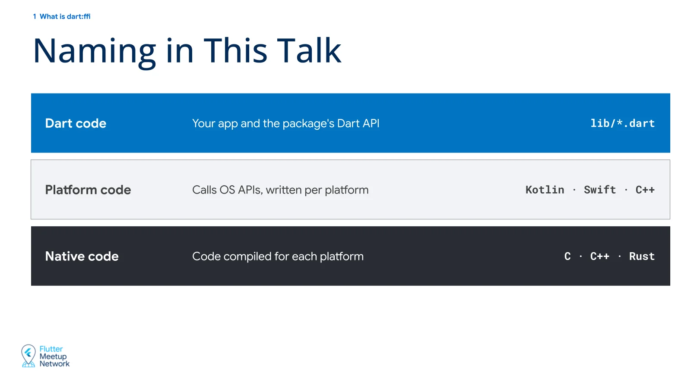

Three terms come up throughout this post, so let's separate them first.

**Dart code** - The Dart you write in Flutter apps and packages.  
**Platform code** - Kotlin and Java on Android, Swift on iOS, and so on.  
**Native code** - C, C++, Rust, and similar code that you call through dart:ffi.

### Why dart:ffi

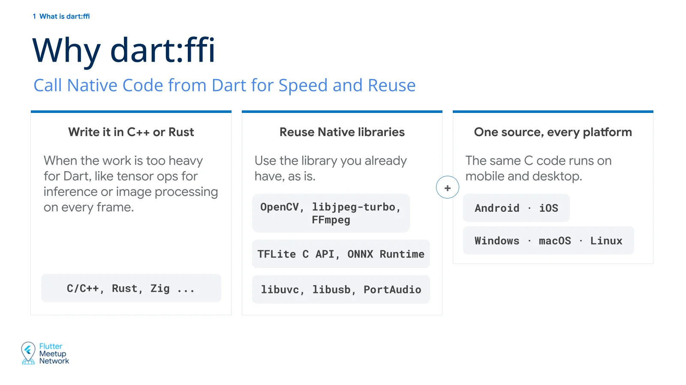

You use it when you want native code.  
And when is that? Usually when you need performance, or when the work involves AI models.

Say you're processing 1920x1080 video at 30fps. You get 33ms per frame, and in that time you have to get through two million pixels. In Dart you would typically loop over the pixels and compute them one at a time. In C++, the compiler or a library can use the CPU's parallel instructions (SIMD) to compute several pixels at once. Add an already tuned library like OpenCV on top and the gap grows to several times, sometimes tens of times.

Being able to use existing native libraries as they are is a big deal too. OpenCV, libjpeg-turbo, FFmpeg, the TFLite C API, ONNX Runtime, and so on.

As a bonus, logic you used to write once per platform can live in a single native source. The same C code runs on Android, iOS, Windows, macOS, and Linux.

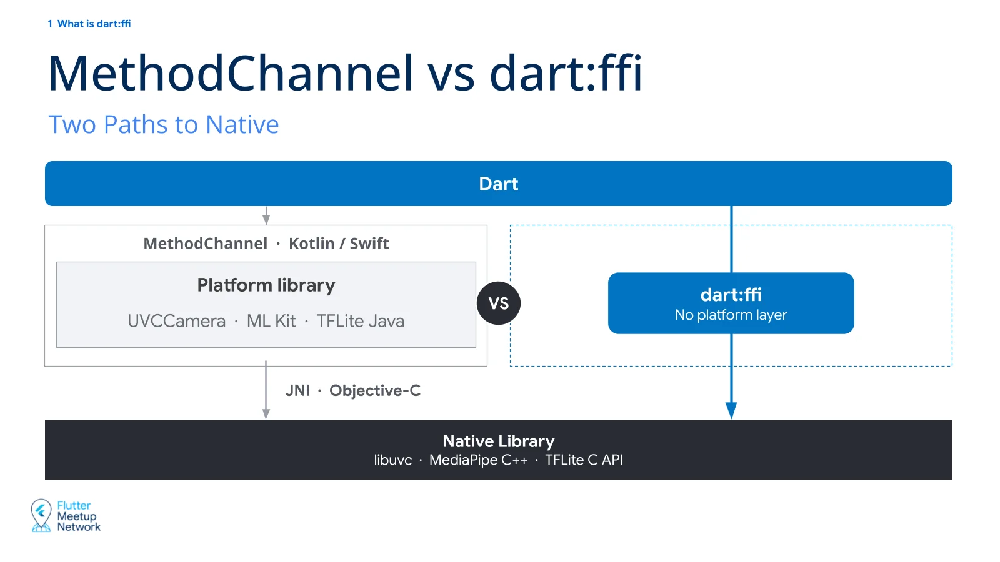

Plenty of packages on pub.dev reach native code by going through platform code. Calling it directly with dart:ffi gets you a few things.
- Less serialization and copy overhead than MethodChannel.
- You can wrap the native library however you like.
- You can follow the latest native source right away instead of waiting for a platform package to update.

Of course, it takes more work than using a package that already exists. Decide based on your own situation.

### How dart:ffi works

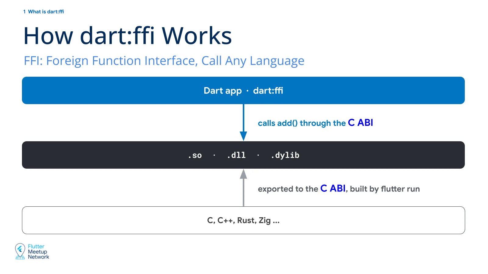

FFI stands for Foreign Function Interface. When you run `flutter run`, the native code is built into a dynamic library for the target platform, such as a `.so`, `.dll`, or `.dylib`. dart:ffi loads that library into memory, looks up functions by symbol name, and calls them.

But every language has its own default way of exporting a library. Build with each language's defaults and Dart can't call the result. So the **C ABI** is used as the common rule. Native code builds its library to the C ABI, and Dart calls it by the same rule.

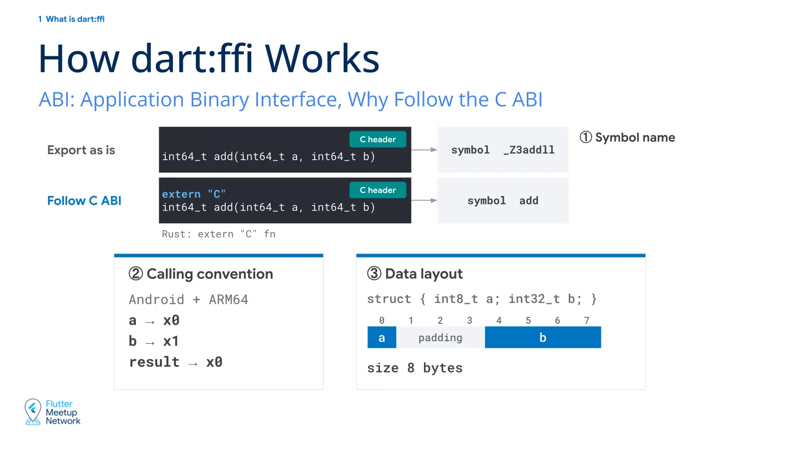

ABI stands for Application Binary Interface. If an API is the rule for how to call a function at the source level, an ABI is the rule for how to call it at the machine code level.

A C ABI is the rule that says "on platform XX, this is how a C function is called." A platform here is a combination of CPU architecture and OS. So there isn't just one C ABI.

For example, on the same x86-64 CPU, Linux passes the first integer argument in the rdi register and Windows passes it in rcx. `long` is 8 bytes on Linux and 4 bytes on Windows.

The rules cover things like these.

**Symbol names**  
The name used to look up a function. Compile C++ as is and `add` turns into something like `_Z3addll` (name mangling). That can't be found by C ABI rules. So each language has syntax for exporting to the C ABI. In C++ it's `extern "C"`, in Rust it's `extern "C" fn`.

**Calling convention**  
Which registers carry the arguments and the return value. On Android ARM64, `a` goes in `x0`, `b` goes in `x1`, and the result comes back in `x0`.

**Data layout**  
How struct fields are laid out in memory. `struct { int8_t a; int32_t b; }` gets 3 bytes of padding after `a`, which makes it 8 bytes.

If the two sides don't agree on these, Dart either can't find the function in the library or exchanges the wrong values.

## 2. Building an FFI package

### Package structure

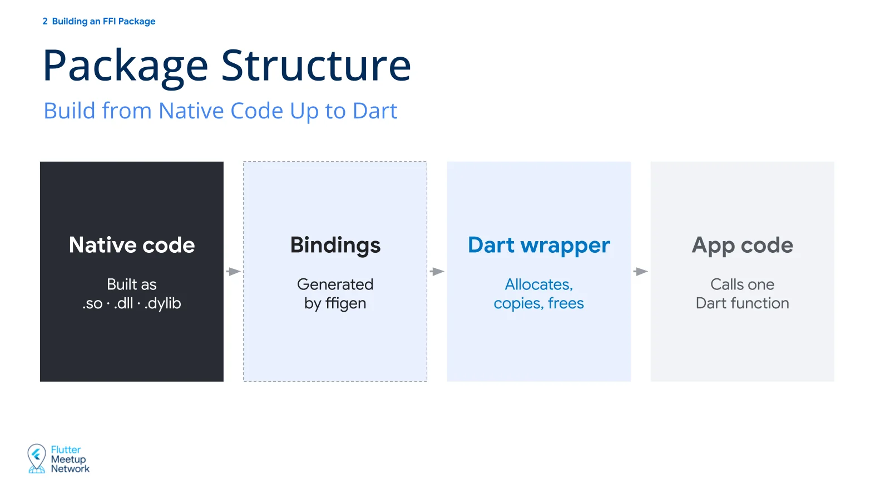

From the package's point of view there are three areas.

**Native**  
The native sources in C, C++, Rust, and so on. Building them produces a dynamic library such as a `.so`, `.dll`, or `.dylib`. Along with the sources you need build configuration.

**Bindings**  
The interface that loads the built library and lets Dart call native functions. Generated with ffigen.

**Dart Wrapper**  
The API that users of the package actually call. It calls the bindings and takes care of allocating, copying, and freeing memory.

### Native

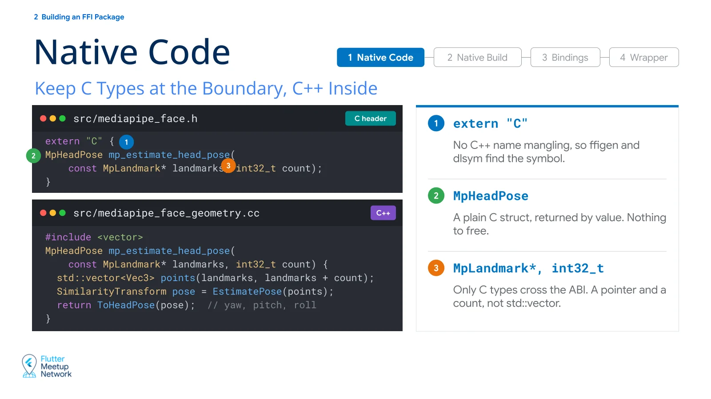

```c
extern "C" {
MpHeadPose mp_estimate_head_pose(
    const MpLandmark* landmarks, int32_t count);
}
```
{: file="src/mediapipe_face.h" }

```cpp
#include <vector>
MpHeadPose mp_estimate_head_pose(
    const MpLandmark* landmarks, int32_t count) {
  std::vector<Vec3> points(landmarks, landmarks + count);
  SimilarityTransform pose = EstimatePose(points);
  return ToHeadPose(pose);  // yaw, pitch, roll
}
```
{: file="src/mediapipe_face_geometry.cc" }

As covered above, the function has to be exported to the C ABI. That's why the header uses `extern "C"`. With it, C++ name mangling doesn't happen, so ffigen and `dlsym` can find the symbol.

But `extern "C"` only makes the symbol name C-style. It doesn't turn C++ types into C types. The C ABI is the rule for how a C function is called. So for any function Dart calls, the arguments and the return value have to be C types or pointers.

In the example above:  
The argument is not a `std::vector` but a pointer and a count (`MpLandmark*`, `int32_t`).  
The return value `MpHeadPose` is a C struct returned by value, so there is nothing to free.

As long as the call boundary uses C types, the implementation behind it is free to do whatever it wants.

### Native build: FFI plugin

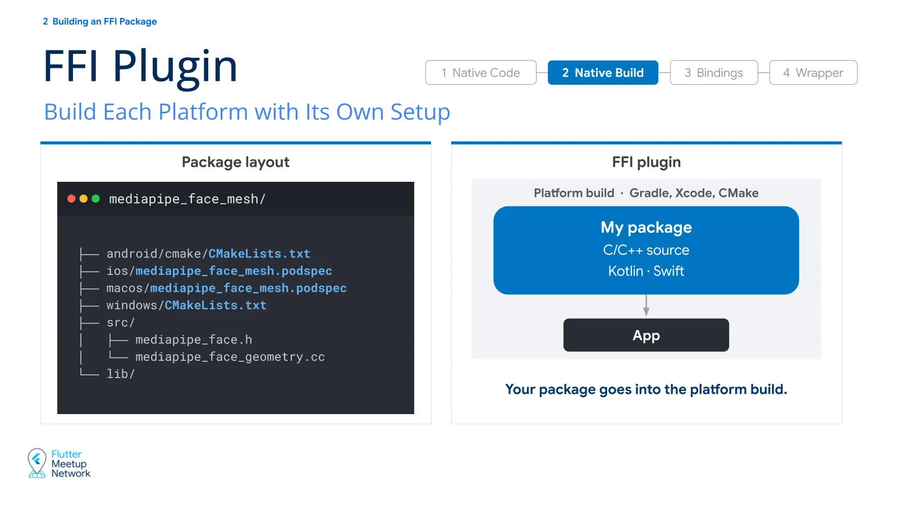

There are two ways to build the native code: as a plugin or as a package.

```
mediapipe_face_mesh/
├── android/cmake/CMakeLists.txt
├── ios/mediapipe_face_mesh.podspec
├── macos/mediapipe_face_mesh.podspec
├── windows/CMakeLists.txt
├── src/
│   ├── mediapipe_face.h
│   └── mediapipe_face_geometry.cc
└── lib/
```

A plugin keeps a build configuration file for each platform.

In this setup the package becomes part of the platform build and is built along with it. On Android, Gradle reads the build configuration and compiles the C++ with the NDK's clang.

Because the native build happens inside the platform build, an FFI plugin can ship platform code (Kotlin, Swift) alongside it.

### Native build: FFI package (build hook)

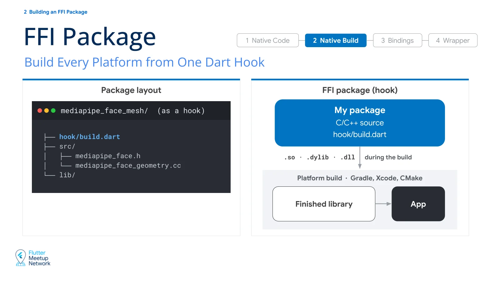

The package approach is the newer one. **With a plugin, the native build is tied to the platform build, so it couldn't be built with Dart alone, without Flutter. The package approach exists to get past that limitation.**

```
mediapipe_face_mesh/
├── hook/build.dart
├── src/
│   ├── mediapipe_face.h
│   └── mediapipe_face_geometry.cc
└── lib/
```

Here a single file, `hook/build.dart`, configures the build for every platform.

A Dart script builds the native code outside the platform build and hands the finished library to Gradle. It still compiles with the NDK's clang, same as a plugin, but the Dart script drives the process instead of Gradle.

That's why **an FFI package currently can't include platform code.** There has been discussion about letting Java bytecode be bundled into the app the way native assets are, but it hasn't moved forward yet.

If an FFI package needs both platform code and native code, for now it has to be a plugin.

### Bindings: ffigen

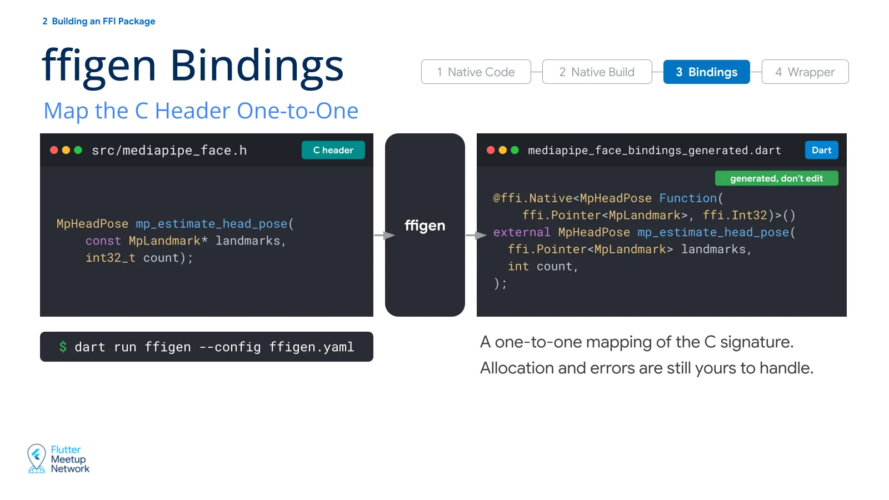

```bash
dart run ffigen --config ffigen.yaml
```

Bindings are the interface Dart uses to call native functions. ffigen reads the C header and generates them for you.

```dart
@ffi.Native<MpHeadPose Function(
    ffi.Pointer<MpLandmark>, ffi.Int32)>()
external MpHeadPose mp_estimate_head_pose(
  ffi.Pointer<MpLandmark> landmarks,
  int count,
);
```
{: file="mediapipe_face_bindings_generated.dart" }

The generated file contains the functions and types from the C header, written out as Dart declarations.

The generated code differs a little between the plugin and package approaches, but it does the same thing. It loads the built native library, finds the function's address by symbol name, and calls it.

### Dart Wrapper

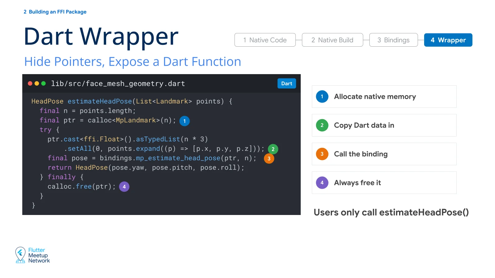

The wrapper handles memory and calls the binding functions. For users of the package, the wrapper is the API. They call `estimateHeadPose()` and never have to think about memory.

```dart
HeadPose estimateHeadPose(List<Landmark> points) {
  final n = points.length;
  final ptr = calloc<MpLandmark>(n);              // 1. allocate native memory
  try {
    ptr.cast<ffi.Float>().asTypedList(n * 3)      // 2. copy the Dart data
        .setAll(0, points.expand((p) => [p.x, p.y, p.z]));
    final pose = bindings.mp_estimate_head_pose(ptr, n);  // 3. call the binding
    return HeadPose(pose.yaw, pose.pitch, pose.roll);
  } finally {
    calloc.free(ptr);                             // 4. always free
  }
}
```
{: file="lib/src/face_mesh_geometry.dart" }

### Third-Party Libraries

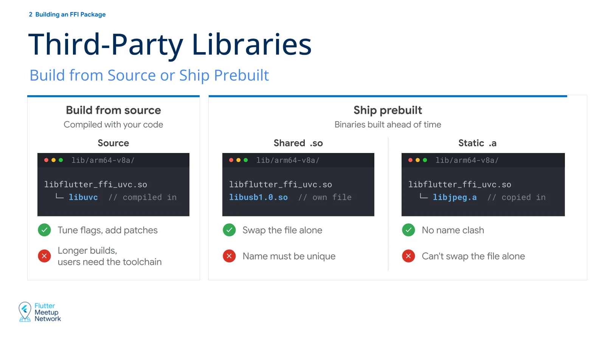

There are roughly three ways to include a third-party library.

| Approach | Pros | Cons |
| --- | --- | --- |
| Include the source and build it together | Free to modify the source and tune compile options | Longer builds, and users may need extra build tools |
| Prebuilt shared library (`.so`) | The third-party file can be swapped out on its own | The file name can collide with a library another package uses |
| Prebuilt static library (`.a`) | No separate file, so no name collisions | The third-party part can't be swapped out on its own |

Weigh library size, licensing, how much you need to modify, and so on against your own situation.


## 3. Patterns in practice

### Native State

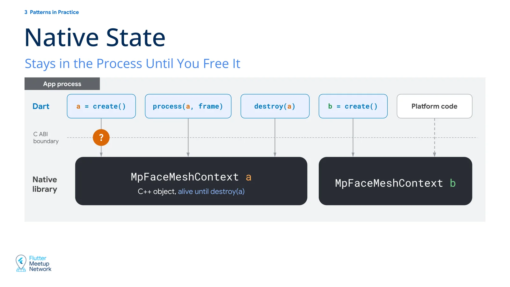

mediapipe_face_mesh is designed so that you can have multiple instances. Calling `create()` loads the model on the native side and creates a state object that holds it. Two things are worth looking at here.

**First,** the state stays around. An FFI call is one function call and then it's over, but the native library stays loaded in the app process. So state created on the native side stays in memory until it's freed.

Also, Dart code, platform code, and native code all live in the same app process. So when Dart changes native state, platform code sees the changed state as is.

**Second,** `MpFaceMeshContext` is a C++ object. But as we saw, only C types can cross the C ABI boundary. So how does Dart receive this C++ object?

### Opaque Pointer

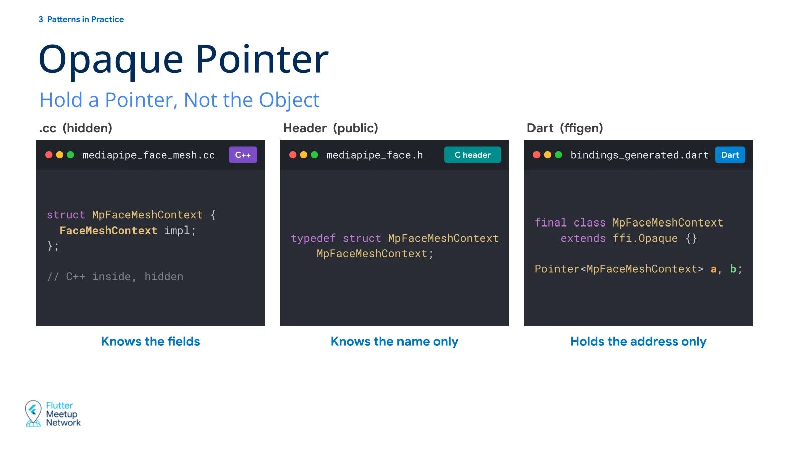

The answer is a pointer. A C++ object can't cross the boundary, but its address can. Dart holds on to that address and passes it back on each call, and the native side uses it to find the original object.

```c
typedef struct MpFaceMeshContext MpFaceMeshContext;
```
{: file="mediapipe_face.h" }

```cpp
struct MpFaceMeshContext {
  FaceMeshContext impl;
};
// C++ inside, hidden
```
{: file="mediapipe_face_mesh.cc" }

```dart
final class MpFaceMeshContext extends ffi.Opaque {}

Pointer<MpFaceMeshContext> a, b;
```
{: file="bindings_generated.dart" }

Passing around a type only as a pointer, with its internals hidden, is called an **opaque pointer**. Only the `.cc` file knows the fields. The C header knows just the name, and Dart holds just the address. Declare only the name in the header, run ffigen, and the bindings get a class that extends `ffi.Opaque`.

### Letting each side do what it's good at

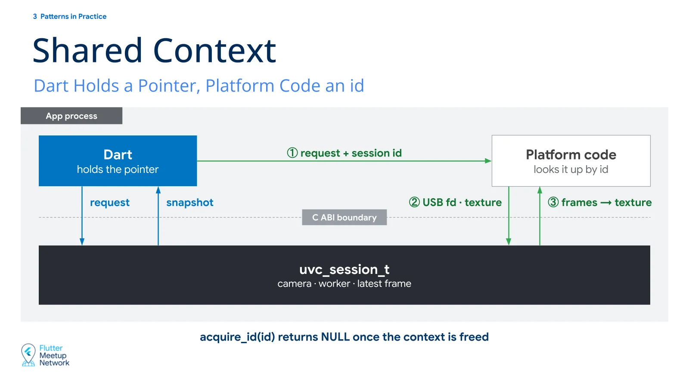

As mentioned, Dart code, platform code, and native code run in one process, so they all see the same native state. That leaves you free to decide which side does which job.

In flutter_ffi_uvc, the USB camera work is split like this.

**Dart makes the requests**  
Requests such as open, close, preview, and take a photo go straight to native over FFI, and the resulting images come straight back over FFI. Only opening the device goes to platform code, along with a session id.

**Platform code opens the device**  
Getting permission and opening the device is the OS API's job. Kotlin opens the device, then passes the file descriptor it got and the texture to draw on to the native side.

**Native runs the camera**  
It opens the camera with the file descriptor it was given, processes incoming frames, and writes them into the texture. Recording, photo capture, and camera controls are handled natively too.

The native context, `uvc_session_t`, is referenced by pointer from Dart and by id from platform code. Platform code has no way of knowing when Dart will free the session, so it takes an id instead of a pointer and checks that the session is still alive every time it uses it.

### Lifetime management

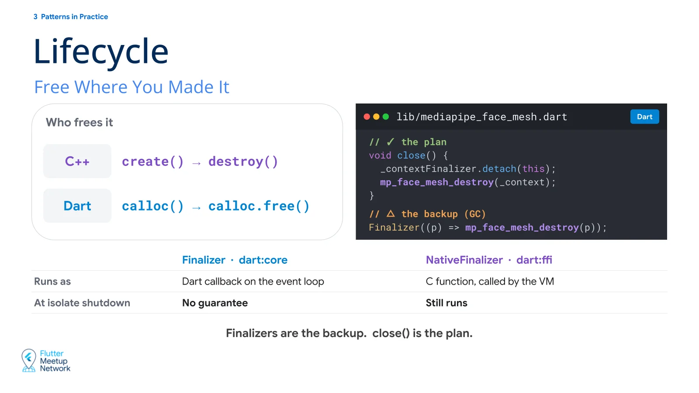

The basic rule is that **whoever creates it frees it.** If Dart allocated with `calloc()`, Dart frees with `calloc.free()`. If native created it with `create()`, native frees it with `destroy()`.

Memory allocated in Dart is the wrapper's responsibility. State created on the native side is only freed when the user calls something like the wrapper's `close()`. So the wrapper API has to be intuitive enough that users don't get it wrong.

```dart
// ✓ the plan
void close() {
  _contextFinalizer.detach(this);
  mp_face_mesh_destroy(_context);
}
// △ the backup (GC)
Finalizer((p) => mp_face_mesh_destroy(p));
```
{: file="lib/mediapipe_face_mesh.dart" }

In case the user never calls `close()`, you can attach a finalizer. There are two kinds, and both run after the Dart object has been garbage collected.

- `Finalizer` runs a Dart callback on the isolate's event loop.
- `NativeFinalizer` has the VM call a native function directly as the callback, not Dart.

Either way, there is no guarantee about when GC happens. So an API that users can follow intuitively is the plan, and the finalizer is insurance.

### Exception handling

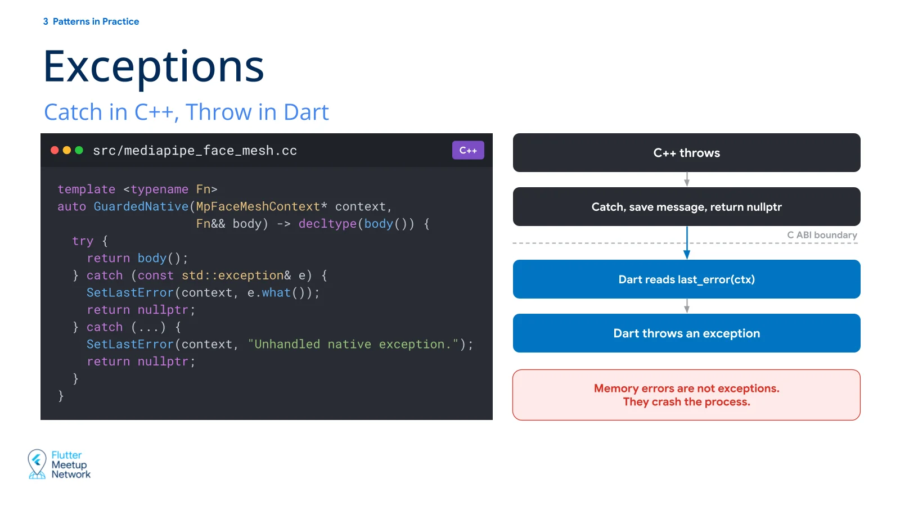

By default, native exceptions don't reach Dart. If you catch one inside C++ and stop there, Dart never learns that the call failed, and you're left with an invisible bug. So I recommend writing one guard function that reports failures all the way up to Dart, and using it everywhere.

```cpp
template <typename Fn>
auto GuardedNative(MpFaceMeshContext* context,
                   Fn&& body) -> decltype(body()) {
  try {
    return body();
  } catch (const std::exception& e) {
    SetLastError(context, e.what());
    return nullptr;
  } catch (...) {
    SetLastError(context, "Unhandled native exception.");
    return nullptr;
  }
}
```
{: file="src/mediapipe_face_mesh.cc" }

When an exception is thrown, it stores the error message in the context and returns `nullptr`. When the Dart wrapper gets `nullptr`, it reads the stored message with `last_error(ctx)` and throws it to the package user as a Dart exception.

Memory errors such as an invalid pointer access are not exceptions. The guard can't catch them, and the process dies.

### Async patterns

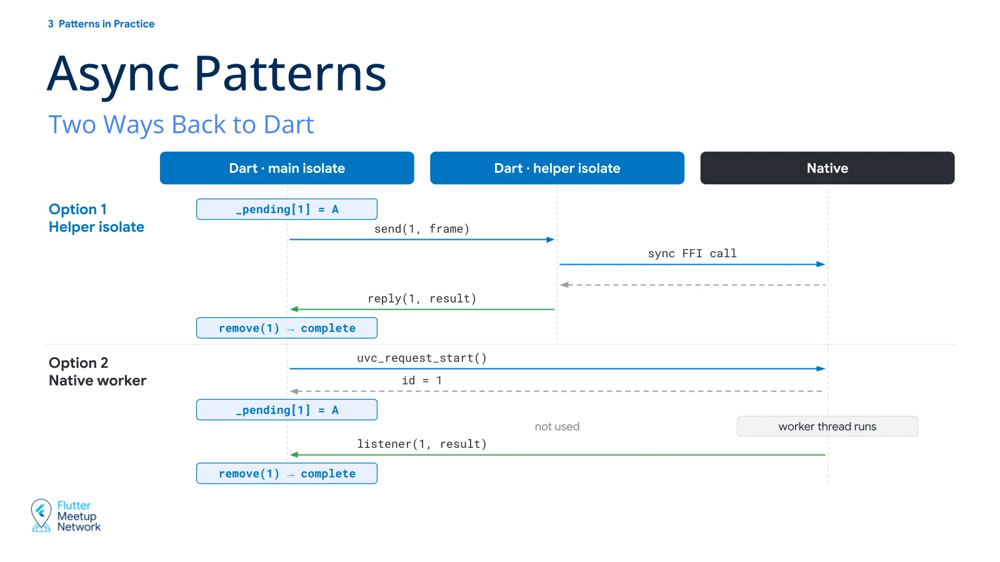

FFI calls are synchronous by default. Call something heavy on the main isolate and the UI freezes until it returns. So you use an async pattern that moves the heavy work off the main isolate. There are two ways to do it.

**Helper isolate**  
Spin up one isolate on the Dart side and keep reusing it. The main isolate sends each request with an id, and the helper isolate makes the synchronous FFI call and sends the result back.

- Easy to implement.
- Hard to interrupt an FFI call once it has started.

Data moving between isolates is copied, not handed over. Pass a pointer between isolates and the address is copied, so now both isolates have to care about its lifetime. It's safer to create native pointers inside the helper isolate and free them there too.

**Native worker**  
Keep a worker thread on the native side. Dart creates a callback and hands it to native, and the callback is invoked when the worker thread finishes the job.

- Work in progress can be cancelled.
- Every request goes through a single worker thread, so unintended sequences, such as close being called before start, can be blocked in one place.
- You have to think about synchronization such as locks on the native side, which makes it harder.


## Closing thoughts

These days, with AI in the loop, finding and fixing flaws in code or design has become much easier. That has changed how I think about trust in open source a little.

I used to find it hard to trust a project from a new contributor. It wasn't that I doubted every line of code. It was that there could be flaws the maintainer wasn't aware of, and that made me doubt its stability. So I picked projects with lots of downloads, or ones built by contributors I had reason to trust.

With AI, the odds of making a flawed choice have dropped a lot. Contributors still weigh many options and make many decisions, but more often now those options differ in taste rather than in correctness. There are simply fewer flawed options on the table. So a new project or a fork that has the quality and keeps improving is now a perfectly good choice next to a well-known project that's only being maintained.

In that sense, building a package yourself is worth trying, whether it's internal or public. It's more likely than before that someone will use it, you can add the features you need without waiting for a maintainer to merge them, and understanding the internals as you build is worthwhile too.
