## 서론

Flutter Korea 2026에서 연사로 발표했다. 시작에 앞서 좋은 자리를 만들어 주신 Flutter Korea 운영진분들께 감사의 말씀을 드린다.

나는 dart:ffi로 만든 패키지 두 개를 배포하고 있다.
- [mediapipe_face_mesh](https://pub.dev/packages/mediapipe_face_mesh): Google MediaPipe의 얼굴 인식을 구현한 패키지
- [flutter_ffi_uvc](https://pub.dev/packages/flutter_ffi_uvc): USB 카메라를 제어하고 영상을 처리하는 패키지

native assets 경합 문제로 [dart-lang/sdk](https://github.com/dart-lang/sdk/issues/63933)에 기여한 경험도 있다.

발표는 세 부분으로 나눠 진행했다.

1. dart:ffi가 무엇이고 언제 쓰는가
2. ffi 패키지는 어떻게 구성하고 빌드하는가
3. 패키지를 만들며 어떤 패턴을 썼는가

FFI로 네이티브 코드를 다루면 Flutter로 할 수 있는 일이 한층 넓어진다. 네이티브 도입을 고민하는 분들께 도움이 되었으면 한다.


## 1. dart:ffi란

### 용어 정리

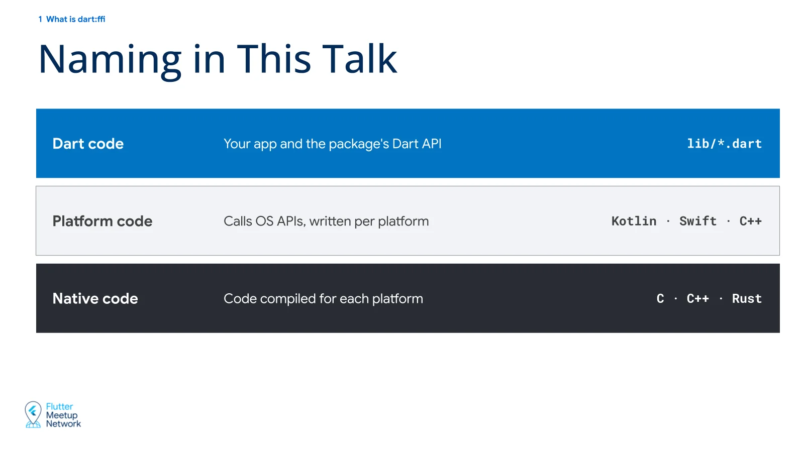

먼저 이 글에서 쓰는 용어 셋을 구분한다.

**Dart code** - Flutter 앱과 패키지에서 작성하는 Dart 코드다.  
**Platform code** - Android의 Kotlin·Java, iOS의 Swift 같은 코드다.  
**Native code** - dart:ffi로 호출하는 C,C++,Rust 같은 코드다.

### 왜 dart:ffi를 쓰는가

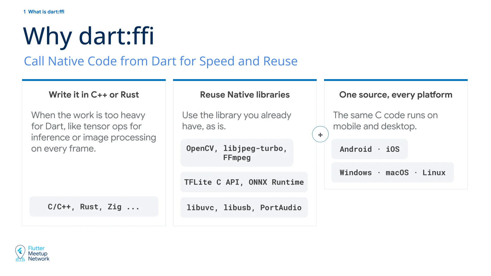

네이티브 코드를 사용하고 싶을 때이다.  
그 때는 언제인가? 보통 성능이 필요하거나 AI모델 관련 작업인 경우가 많다.

1920x1080 영상을 30fps로 처리한다고 해 보자. 한 프레임에 쓸 수 있는 시간은 33ms이고, 그 안에 픽셀 200만 개를 처리해야 한다. Dart로 짜면 보통 픽셀을 하나씩 돌면서 연산한다. C++에서는 컴파일러나 라이브러리가 CPU의 병렬 명령(SIMD)을 써서 픽셀 여러 개를 한 번에 연산할 수 있다. 여기에 OpenCV처럼 이미 튜닝된 라이브러리를 붙이면 속도 차이가 수 배에서 수십 배까지 벌어진다.

이미 있는 네이티브 라이브러리를 그대로 가져다 쓸 수 있다는 점도 크다. OpenCV, libjpeg-turbo, FFmpeg, TFLite C API, ONNX Runtime 같은 것들이다.  

덤으로 플랫폼마다 따로 짜던 로직을 네이티브 소스 하나로 관리할 수 있다. 같은 C 코드가 Android, iOS, Windows, macOS, Linux에서 동작한다.

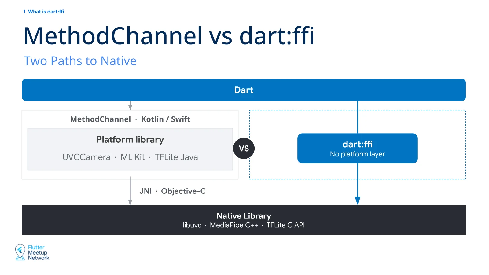

pub.dev 패키지를 살펴보면 플랫폼 코드를 거쳐 네이티브를 부르는 구조도 꽤 있는데, dart:ffi로 직접 호출한다면 다음과 같은 이점을 얻을 수 있다.
- MethodChannel에 비해 직렬화와 복사 오버헤드가 적다.
- 네이티브 라이브러리를 원하는 대로 감쌀 수 있다.
- 플랫폼 패키지 업데이트를 기다리지 않고 네이티브 최신 소스를 바로 따라갈 수 있다.

다만 당연히 이미 만들어진 패키지를 쓰는 것보단 품이 더 든다. 각자의 환경에 맞게 판단하자.

### dart:ffi의 동작 방식

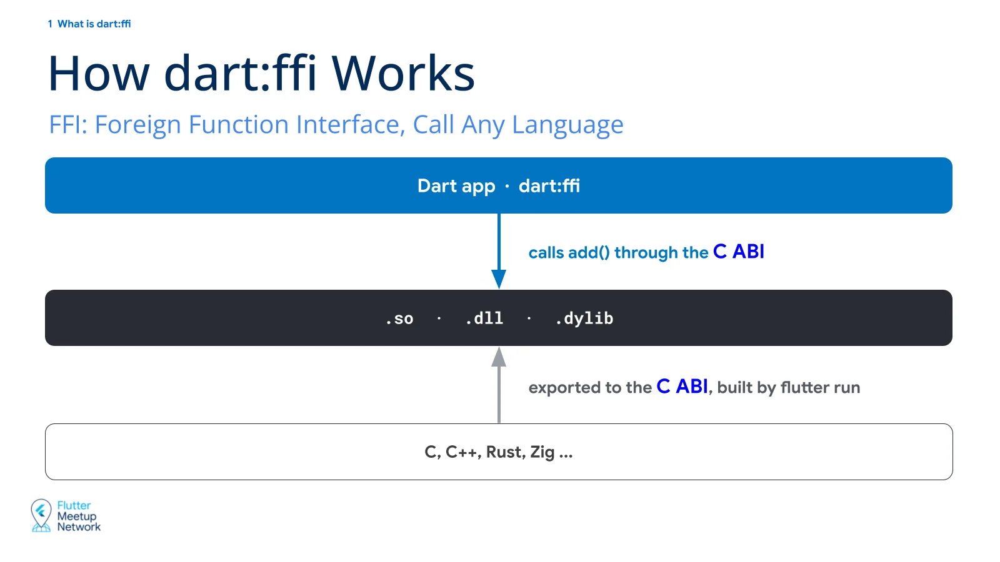

FFI는 Foreign Function Interface의 약자다. `flutter run`을 하면 네이티브 코드는 플랫폼에 맞춰 `.so`, `.dll`, `.dylib` 같은 동적 라이브러리로 빌드된다. dart:ffi는 이 라이브러리를 메모리에 로드하고, 심볼 이름으로 함수를 찾아 호출한다.

그런데 언어마다 라이브러리를 내보내는 기본 방식이 다르다. 각 언어의 기본 방식 그대로 빌드하면 Dart에서 호출할 수 없다. 그래서 **C ABI**를 공통 규칙으로 삼는다. 네이티브 코드는 C ABI에 맞춰 라이브러리를 빌드하고, Dart도 동일한 규칙으로 호출한다.

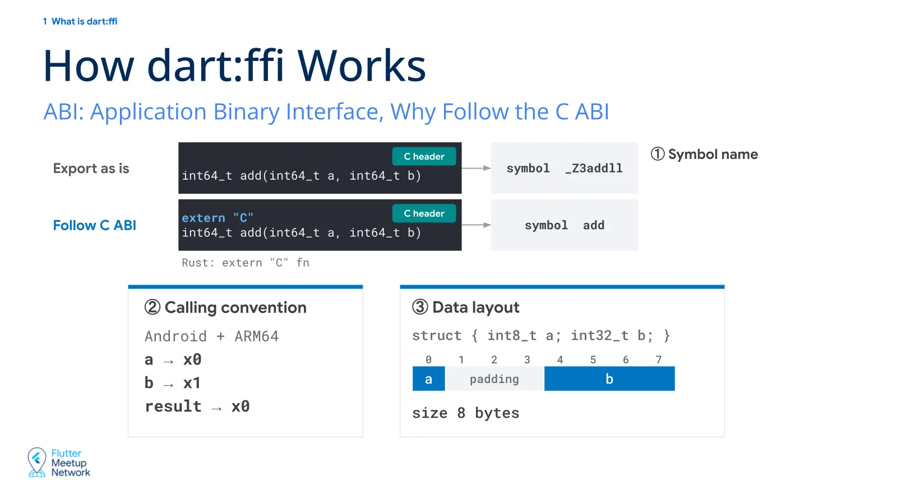

ABI는 Application Binary Interface의 약자다. API가 코드 수준에서 함수를 어떻게 호출할지 정한 규칙이라면, ABI는 기계어 수준에서 함수를 어떻게 호출할지 정한 규칙이다.

C ABI는 "XX플랫폼에서 C 함수는 이렇게 부른다"고 정한 규칙이다. 여기서 플랫폼은 CPU 아키텍처와 OS의 조합이다. 그래서 C ABI는 하나가 아니다.

예를 들어 같은 x86-64 CPU라도 Linux는 첫 번째 정수 인자를 rdi 레지스터로, Windows는 rcx 레지스터로 넘긴다. long도 Linux에서는 8바이트, Windows에서는 4바이트다.

규칙에는 이런 것들이 포함된다.

**심볼 이름**  
함수를 찾을 때 쓰는 이름이다. C++을 그대로 컴파일하면 `add`가 `_Z3addll` 같은 이름으로 바뀐다(name mangling). 이러면 C ABI 규칙으로 찾을 수 없다. 그래서 언어마다 C ABI에 맞춰 내보내는 문법이 있다. C++은 `extern "C"`, Rust는 `extern "C" fn`이다.

**호출 규약**  
인자와 반환값을 어떤 레지스터로 주고받을지 정한다. Android ARM64라면 `a`는 `x0`, `b`는 `x1`으로 들어가고 결과는 `x0`으로 나온다.

**데이터 레이아웃**  
구조체 필드를 메모리에 어떻게 배치할지 정한다. `struct { int8_t a; int32_t b; }`는 `a` 뒤에 패딩 3바이트가 들어가서 크기가 8바이트가 된다.

이 약속이 서로 맞지 않으면 Dart가 라이브러리에서 함수를 찾지 못하거나 잘못된 값을 주고받는다.

## 2. FFI 패키지 만들기

### 패키지 구성

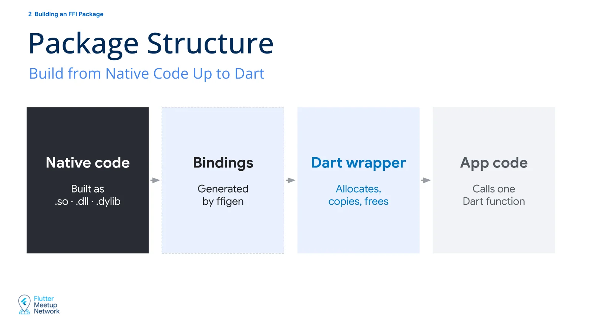

패키지 관점에서 크게 세 영역으로 바라볼 수 있다.

**Native**  
C·C++, Rust 등 네이티브 소스가 있고, 빌드하면 `.so`, `.dll`, `.dylib` 같은 동적 라이브러리가 된다. 네이티브 소스와 함께 빌드 설정이 필요하다.

**Bindings**  
빌드된 라이브러리를 로드하고 Dart에서 네이티브 함수를 호출하게 해 주는 인터페이스다. ffigen으로 생성한다.

**Dart Wrapper**  
패키지 사용자가 호출할 API라 볼 수 있다. 바인딩 호출과 메모리 할당·복사·해제를 맡는다.

### Native

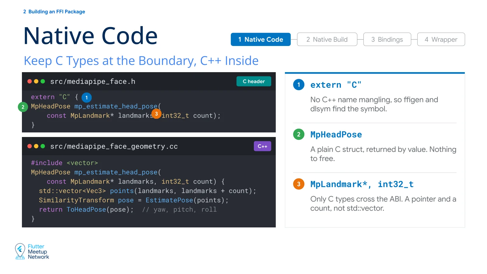

```c
extern "C" {
MpHeadPose mp_estimate_head_pose(
    const MpLandmark* landmarks, int32_t count);
}
```
{: file="src/mediapipe_face.h" }

```cpp
#include <vector>
MpHeadPose mp_estimate_head_pose(
    const MpLandmark* landmarks, int32_t count) {
  std::vector<Vec3> points(landmarks, landmarks + count);
  SimilarityTransform pose = EstimatePose(points);
  return ToHeadPose(pose);  // yaw, pitch, roll
}
```
{: file="src/mediapipe_face_geometry.cc" }

앞에서 말한 대로 C ABI에 맞춰 내보내야 한다. 그래서 헤더에 `extern "C"`를 붙인다. 이러면 C++ name mangling이 일어나지 않아 ffigen과 `dlsym`이 심볼을 찾을 수 있다.

그런데 `extern "C"`는 심볼 이름을 C 방식으로 바꿀 뿐, C++ 타입을 C 타입으로 바꿔 주지는 않는다. C ABI는 “C 함수를 이렇게 부른다”는 규칙이다. 그래서 Dart가 호출하는 함수는 인자와 반환값을 C 타입이나 포인터로 맞춰야 한다.

위 예시에서는  
인자는 `std::vector`가 아니라 포인터와 개수(`MpLandmark*`, `int32_t`)로 받았고.  
반환값 `MpHeadPose`은 C 구조체이고 값으로 돌려준다. 해제할 것이 없다.

호출 경계만 C 타입으로 맞추면 내부 구현은 자유롭다.

### Native Build: FFI plugin

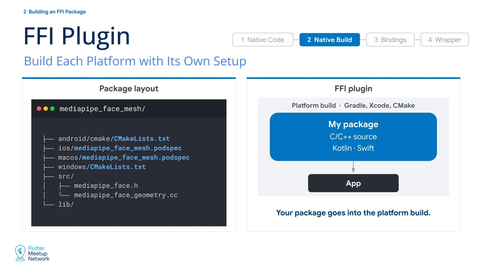

네이티브 코드를 빌드하는 방법은 plugin 방식과 package 방식 두 가지가 있다.

```
mediapipe_face_mesh/
├── android/cmake/CMakeLists.txt
├── ios/mediapipe_face_mesh.podspec
├── macos/mediapipe_face_mesh.podspec
├── windows/CMakeLists.txt
├── src/
│   ├── mediapipe_face.h
│   └── mediapipe_face_geometry.cc
└── lib/
```
plugin 방식은 플랫폼마다 빌드 설정 파일을 둔다.

이 방식에서는 내 패키지가 플랫폼 빌드 안에 들어가 함께 빌드된다. Android라면 Gradle이 빌드 설정을 읽고, NDK의 clang으로 C++을 컴파일한다.  

네이티브 빌드가 플랫폼 빌드 안에서 이루어지기 때문에 FFI 패키지에 플랫폼 코드(Kotlin, Swift)를 같이 넣을 수 있다.

### 네이티브 빌드 2: FFI package (build hook)

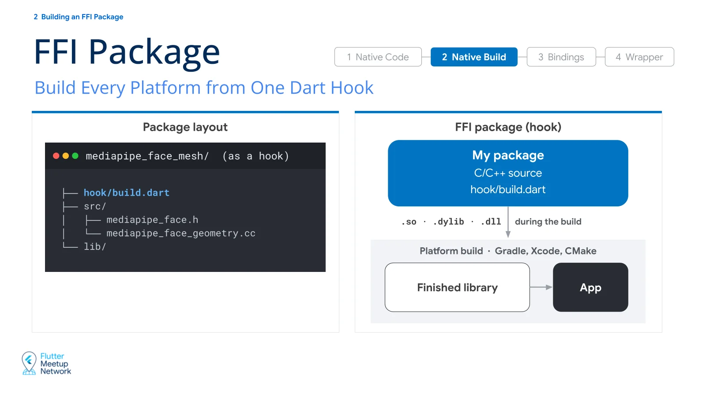

package 방식은 더 최근에 나온 방식이다. **plugin은 네이티브 빌드가 플랫폼 빌드에 묶여 있어서 Flutter 없이 Dart만으로 빌드 할 수 없었다. 이 한계를 벗어나려고 나온 것이 package 방식이다.**

```
mediapipe_face_mesh/
├── hook/build.dart
├── src/
│   ├── mediapipe_face.h
│   └── mediapipe_face_geometry.cc
└── lib/
```

package 방식에서는 `hook/build.dart` 파일 하나로 모든 플랫폼의 빌드를 설정한다.  

플랫폼 빌드 밖에서 Dart 스크립트가 네이티브 코드를 빌드하고, 완성된 라이브러리를 Gradle에 넘긴다. NDK의 clang으로 컴파일하는 건 plugin 방식과 같지만 그 과정을 Gradle이 아니라 Dart 스크립트가 주도한다.

그래서 **현재는 package 방식에는 플랫폼 코드를 함께 넣을 수 없다.** Java 바이트코드도 native assets처럼 앱에 넣을 수 있게 하자는 논의가 있지만 아직 진행되지 않았다.  

FFI 패키지 안에 플랫폼 코드와 Native 코드 둘 다 필요하다면 현재는 plugin 방식을 쓴다.

### Bindings: ffigen

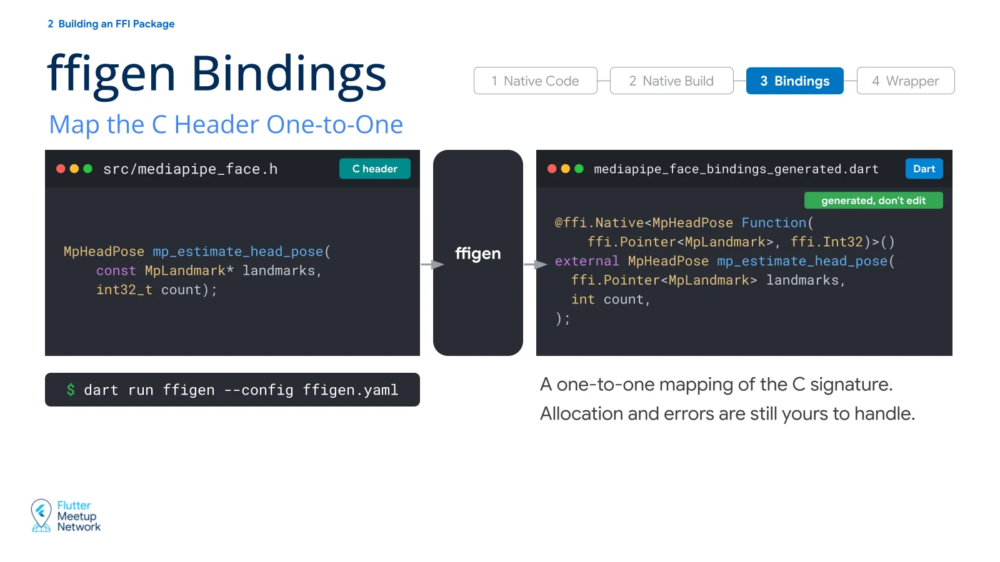

```bash
dart run ffigen --config ffigen.yaml
```
바인딩은 Dart에서 네이티브 함수를 호출하는 인터페이스로, ffigen으로 C 헤더를 읽어 자동 생성한다.

```dart
@ffi.Native<MpHeadPose Function(
    ffi.Pointer<MpLandmark>, ffi.Int32)>()
external MpHeadPose mp_estimate_head_pose(
  ffi.Pointer<MpLandmark> landmarks,
  int count,
);
```
{: file="mediapipe_face_bindings_generated.dart" }

생성된 파일에는 C 헤더의 함수와 타입이 Dart 선언으로 그대로 만들어져 있다.

plugin 방식과 package 방식에 따라 생성되는 코드는 조금 다르지만 동작은 같다. 빌드된 네이티브 라이브러리를 로드하고, 심볼 이름으로 함수 주소를 찾아 호출한다.

### Dart Wrapper

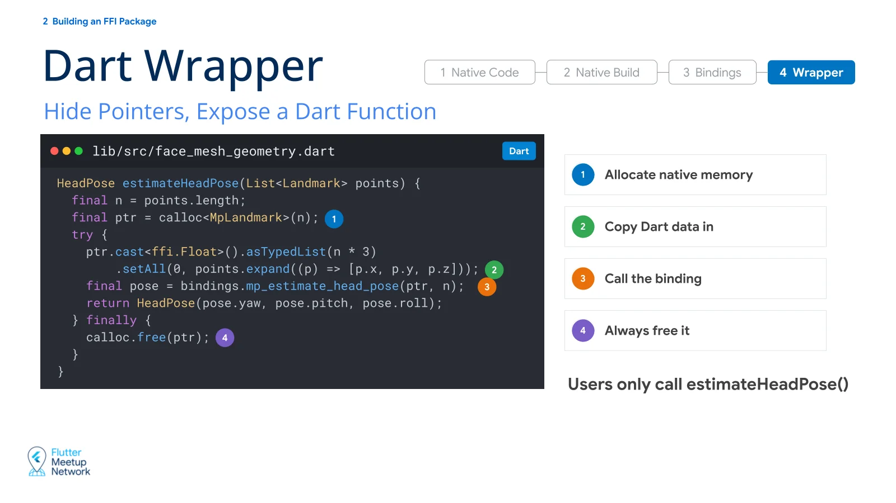

Wrapper는 메모리를 처리하고 바인딩 함수를 호출한다. 패키지 사용자 입장에서는 래퍼가 곧 API다. 사용자는 메모리 처리 로직을 신경쓰지 않고 `estimateHeadPose()`만 부르면 된다.

```dart
HeadPose estimateHeadPose(List<Landmark> points) {
  final n = points.length;
  final ptr = calloc<MpLandmark>(n);              // 1. 네이티브 메모리 할당
  try {
    ptr.cast<ffi.Float>().asTypedList(n * 3)      // 2. Dart 데이터 복사
        .setAll(0, points.expand((p) => [p.x, p.y, p.z]));
    final pose = bindings.mp_estimate_head_pose(ptr, n);  // 3. 바인딩 호출
    return HeadPose(pose.yaw, pose.pitch, pose.roll);
  } finally {
    calloc.free(ptr);                             // 4. 항상 해제
  }
}
```
{: file="lib/src/face_mesh_geometry.dart" }

### Third-Party Libraries

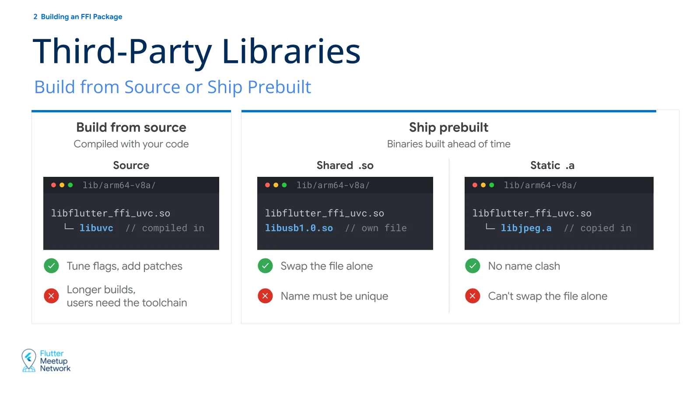

서드파티 라이브러리를 포함하는 방법은 크게 세 가지다.

| 방법                               | 장점                                         | 단점                                                        |
| ---------------------------------- | -------------------------------------------- | ----------------------------------------------------------- |
| 소스를 포함해 함께 빌드            | 소스 수정과 컴파일 옵션 조정이 자유롭다      | 빌드가 길어지고, 사용자에게 추가 빌드 도구가 필요할 수 있다 |
| 미리 빌드한 공유 라이브러리(`.so`) | 서드파티 파일만 따로 교체할 수 있다          | 다른 패키지가 쓰는 라이브러리와 파일 이름이 겹칠 수 있다    |
| 미리 빌드한 정적 라이브러리(`.a`)  | 별도 파일이 생기지 않아 이름이 겹치지 않는다 | 서드파티만 따로 교체할 수 없다                              |

라이브러리 크기, 라이선스, 수정 범위 등 각자 환경에 맞춰 고려하면 된다.


## 3. 실전 패턴

### Native State

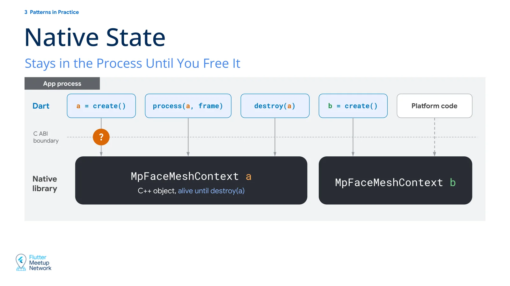

mediapipe_face_mesh는 여러 인스턴스로 쓸 수 있게 설계했다. `create()`를 호출하면 네이티브에서 모델을 로드하고, 이를 담은 상태 객체를 만든다. 여기서 살펴볼 점이 두 가지 있다.

**첫째,** 상태가 계속 남아 있다. FFI 호출은 함수 하나를 부르고 끝나지만, 네이티브 라이브러리는 앱 프로세스에 로드된 채로 유지된다. 그래서 네이티브에서 만든 상태도 해제하기 전까지 메모리에 남는다.

그리고 Dart 코드, 플랫폼 코드, 네이티브 코드는 모두 같은 앱 프로세스 안에 있다. 그래서 Dart에서 네이티브 상태를 바꾸면 플랫폼 코드도 바뀐 상태를 그대로 본다.

**둘째,** `MpFaceMeshContext`는 C++ 객체다. 그런데 앞에서 본 것처럼 C ABI 경계에선 C 타입만 주고받을 수 있다. 그러면 이 C++ 객체는 어떻게 받을까?

### Opaque pointer

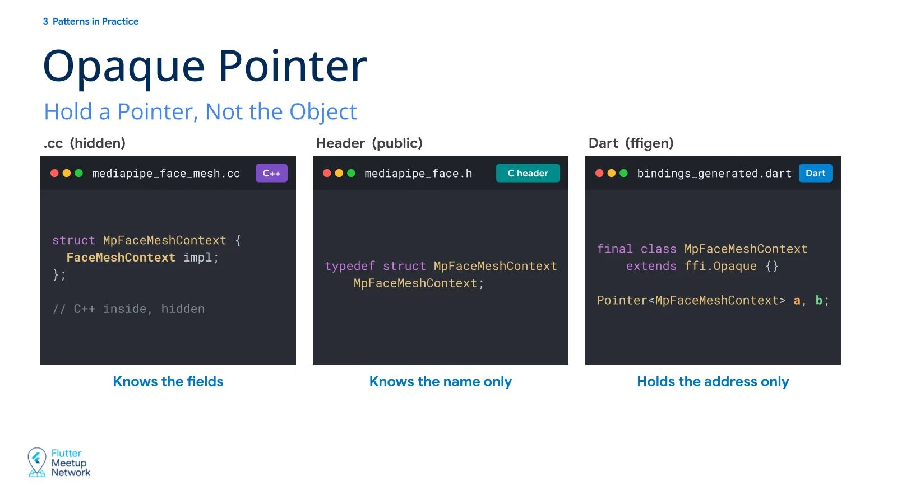

답은 포인터다. C++ 객체는 경계를 넘을 수 없지만, 그 객체의 주소는 넘길 수 있다. Dart는 이 주소를 들고 있다가 함수를 호출할 때 다시 넘기고, 네이티브는 그 주소로 원래 객체를 찾아 쓴다.

```c
typedef struct MpFaceMeshContext MpFaceMeshContext;
```
{: file="mediapipe_face.h" }

```cpp
struct MpFaceMeshContext {
  FaceMeshContext impl;
};
// C++ inside, hidden
```
{: file="mediapipe_face_mesh.cc" }

```dart
final class MpFaceMeshContext extends ffi.Opaque {}

Pointer<MpFaceMeshContext> a, b;
```
{: file="bindings_generated.dart" }

이렇게 내부 구조를 숨긴 타입을 포인터로만 주고받는 방식을 **opaque pointer**라고 한다. 필드를 아는 건 `.cc` 파일뿐이다. C 헤더는 이름만 알고, Dart는 주소만 들고 있다. 헤더에 이름만 선언하고 ffigen을 돌리면 바인딩에 `ffi.Opaque`를 상속한 클래스가 생긴다.

### 각자 잘하는 일 나눠 맡기

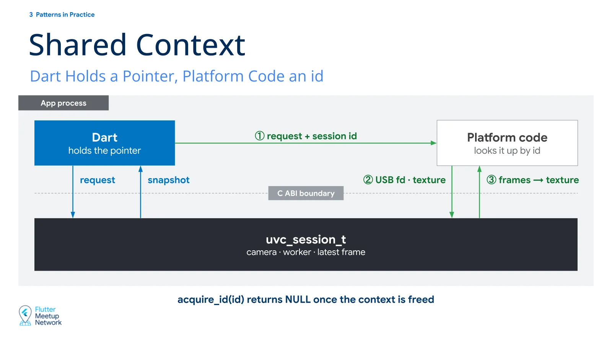

앞에서 잠깐 언급했듯이 Dart 코드, 플랫폼 코드, 네이티브 코드는 한 프로세스 안에서 돌기 때문에 같은 네이티브 상태를 함께 본다. 그래서 일을 어느 쪽에 맡길지 꽤 자유롭게 나눌 수 있다.

flutter_ffi_uvc에서는 USB 카메라 작업을 이렇게 나눴다.

**요청은 Dart가**  
카메라 열기, 닫기, 프리뷰, 사진 촬영 같은 요청을 FFI로 네이티브에 바로 보내고, 결과 이미지도 FFI로 바로 받는다. 장치를 열 때만 세션 id와 함께 플랫폼 코드에 요청한다.

**장치 열기는 플랫폼 코드가**  
권한을 받고 장치를 여는 건 OS API의 일이다. Kotlin이 장치를 열어 얻은 file descriptor와 화면에 쓸 texture를 네이티브에 넘긴다.

**카메라 구동은 네이티브가**  
넘겨받은 file descriptor로 카메라를 열고, 들어온 프레임을 처리해 texture에 채워 넣는다. 녹화, 사진 촬영, 카메라 컨트롤도 네이티브에서 처리한다.

네이티브 컨텍스트인 `uvc_session_t`를 Dart는 포인터로, 플랫폼 코드는 id로 가리킨다. 플랫폼 코드는 Dart가 세션을 언제 해제할지 모르기 때문에, 포인터 대신 id로 받아서 쓸 때마다 살아 있는지 확인한다.

### 수명 관리

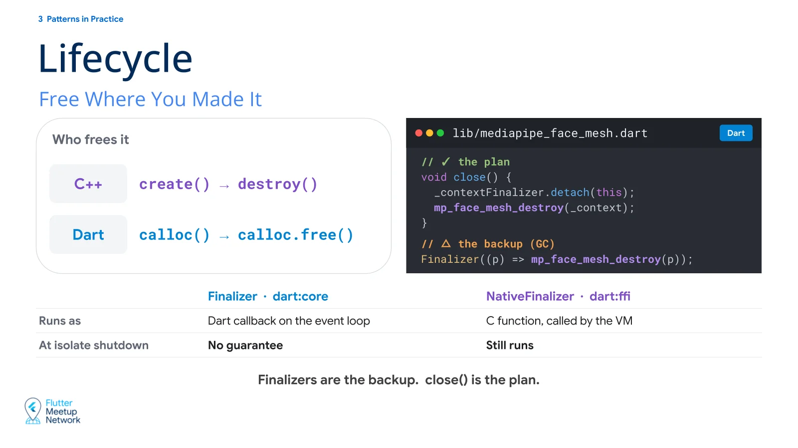

기본 원칙은 **만든 쪽에서 해제한다**는 것이다. Dart에서 `calloc()`으로 할당했으면 Dart에서 `calloc.free()`로, 네이티브에서 `create()`로 만들었으면 네이티브의 `destroy()`로 해제한다.

Dart에서 할당한 메모리는 래퍼가 책임진다. 네이티브에서 만든 상태는 사용자가 래퍼의 `close()` 같은 함수를 불러 줘야 해제된다. 그래서 래퍼 API를 직관적으로 설계해야 사용자가 헷갈리지 않는다.

```dart
// ✓ the plan
void close() {
  _contextFinalizer.detach(this);
  mp_face_mesh_destroy(_context);
}
// △ the backup (GC)
Finalizer((p) => mp_face_mesh_destroy(p));
```
{: file="lib/mediapipe_face_mesh.dart" }

사용자가 `close()`를 부르지 않을 때를 대비해 finalizer를 걸어 둘 수 있다. 두 종류가 있고, 둘 다 Dart 객체가 GC된 뒤에 실행된다.

- `Finalizer`는 isolate의 이벤트 루프에서 Dart 콜백으로 실행된다.
- `NativeFinalizer`는 VM이 Dart가 아닌 네이티브 함수를 콜백으로 바로 호출한다.

다만 어느 쪽이든 GC 시점은 보장되지 않는다. 그래서 사용자가 직관적으로 따를 수 있는 API가 기본이고, finalizer는 보험이다.

### 예외 처리

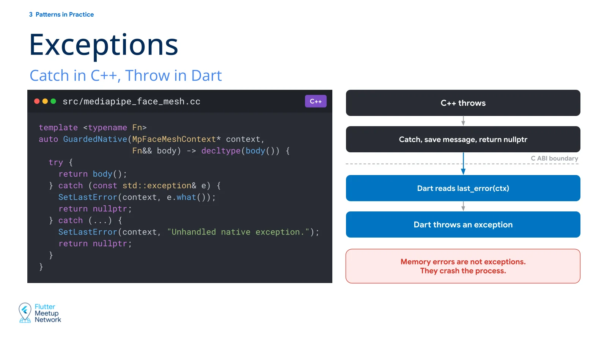

네이티브 예외는 기본적으로 Dart까지 전달되지 않는다. C++ 안에서 잡고 끝내면 Dart는 실패한 줄 모르고, 눈에 보이지 않는 버그로 남는다. 그래서 Dart까지 실패를 알리는 가드 함수를 하나 만들어 전반에 적용하기를 추천한다.

```cpp
template <typename Fn>
auto GuardedNative(MpFaceMeshContext* context,
                   Fn&& body) -> decltype(body()) {
  try {
    return body();
  } catch (const std::exception& e) {
    SetLastError(context, e.what());
    return nullptr;
  } catch (...) {
    SetLastError(context, "Unhandled native exception.");
    return nullptr;
  }
}
```
{: file="src/mediapipe_face_mesh.cc" }

예외가 나면 에러 메시지를 컨텍스트에 저장하고 `nullptr`를 반환한다. Dart 래퍼는 `nullptr`를 받으면 저장된 메시지를 `last_error(ctx)`로 읽고, 패키지 사용자에게 Dart 예외로 던진다.

> 잘못된 포인터 접근 같은 메모리 오류는 예외가 아니다. 가드로 잡을 수 없고 프로세스가 종료된다.
{: .prompt-warning }

### 비동기 패턴

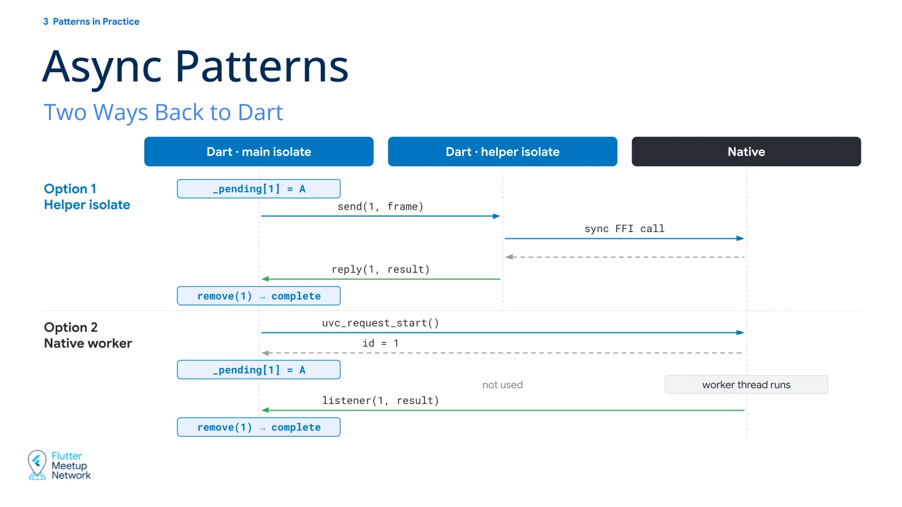

FFI 호출은 기본적으로 동기다. main isolate에서 무거운 작업을 호출하면 끝날 때까지 UI가 멈춘다. 그래서 무거운 작업을 main isolate 밖으로 빼는 비동기 패턴을 쓴다. 방법은 두 가지다.

**helper isolate.** Dart에 isolate를 하나 띄워 두고 계속 쓰는 방식이다. main isolate가 요청에 id를 붙여 보내면, helper isolate가 동기 FFI 호출을 하고 결과를 돌려준다.

- 구현이 쉽다.
- 이미 호출된 FFI 함수를 중간에 끊기는 어렵다.

isolate 간 데이터 이동은 전달이 아니라 복사다. 포인터를 isolate 사이로 넘기면 주소가 복사돼서, 양쪽 isolate 모두에서 수명을 신경 써야 한다. 그래서 네이티브 포인터는 helper isolate 안에서 만들고 해제까지 그 안에서 끝내는 것이 안전하다.

**native worker.** 네이티브에 worker 스레드를 두는 방식이다. Dart에서 콜백을 만들어 네이티브에 넘겨 두고, worker 스레드가 작업을 끝내면 콜백이 호출된다.

- 진행 중인 작업을 취소할 수 있다.
- start 전에 close가 호출되는 것처럼 순서가 꼬이는 상황을 막는 규칙을 worker 스레드 한곳에서 제어할 수 있다.
- 네이티브에서 락 같은 동기화를 고려해야 해서 난이도가 올라간다.


## 마치며

요즘은 AI를 활용하면서 코드나 설계의 결함을 찾고 개선하는 일이 훨씬 쉬워졌다. 그래서 오픈소스 신뢰도에 대한 생각도 조금 달라졌다.

예전에는 새로운 기여자의 프로젝트를 믿기 어려웠다. 코드 하나하나를 의심해서라기보다, maintainer가 인지하지 못한 결함이 있을 수 있다는 점에서 안정성을 의심했다. 그래서 다운로드 수가 많거나 신뢰할 만한 기여자가 만든 프로젝트를 골랐다.

AI를 활용하면서 결함이 있는 선택을 할 가능성이 많이 줄었다. 기여자는 여전히 많은 선택과 고민을 하지만, 그 후보들은 성향의 차이인 경우가 많아졌다. 결함이 있는 선택지 자체가 줄어든 것이다. 그래서 유명하지만 유지보수에 머무는 프로젝트보다, 품질을 갖추고 계속 개선되는 새 프로젝트나 파생 프로젝트도 충분히 좋은 선택지가 됐다.

그런 면에서 내부용이든 공개용이든 직접 패키지를 만들어 보는 건 해 볼 만하다. 누군가에게 쓰일 확률도 높아졌고, 필요한 기능을 바로 넣을 수 있고, 만드는 과정에서 내부 동작을 공부하게 되니 재미있다.
